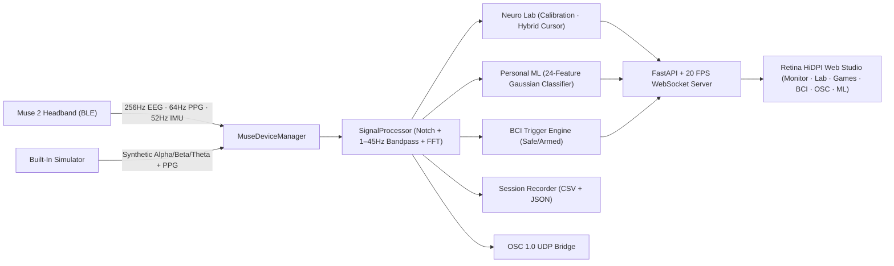

<div align="center">

# 🧠 Brain Museum Studio

**Native Linux & Cross-Platform Muse 2 EEG/PPG Studio, Neurofeedback Lab, Mind-Controlled Games, BCI Automation, OSC Bridge, and Personal ML.**


*Built for low-latency direct Bluetooth LE streaming — no proprietary desktop wrapper required.*

</div>

---

## ✨ Why Brain Museum Studio?

Official Muse desktop SDK binaries only target Windows, macOS, iOS, and Android. **Brain Museum Studio** talks directly to your **Muse 2** headband over native Bluetooth LE (`bleak` / BlueZ on Linux, CoreBluetooth on macOS, WinRT on Windows), runs a real-time **NumPy + SciPy DSP pipeline**, and delivers a crisp **Apple + Google inspired** Dark/Light web studio at `60 FPS`.

- **Zero-Friction Native Linux Support:** Connects directly to Muse 2 on Ubuntu & Pop!_OS (including COSMIC Wayland).
- **Built-In Realistic Simulator:** Develop, test BCI rules, train ML models, and play mind-controlled games even without wearing the headset.
- **Safety-First Automation:** OS mouse, OS typing, and BCI desktop triggers default to **SAFE (Dry-Run)** until explicitly armed.

---

## 🏗️ System Architecture



---

## 🎛️ Studio Modules

### 1. Live Monitor
- **Retina-Crisp 4-Channel EEG Oscilloscope:** `TP9`, `AF7`, `AF8`, and `TP10` at 256 Hz with live per-channel **RMS (µV)** and a 4-node **Electrode Fit** indicator.
- **Real-Time IIR Filters:** Toggleable stateful Butterworth **Notch Filter** (`60 Hz` US / `50 Hz` EU / `Off`) and **1–45 Hz Bandpass Filter**.
- **Cognitive State & Spectrum:** Activity rings for **Focus** and **Calm**, relative band power bars (**Delta, Theta, Alpha, Beta, Gamma**), and a live **1–45 Hz FFT Power Spectrum**.
- **Optical PPG & IMU:** 64 Hz infrared pulse waveform with live **Heart Rate (BPM)**, 3-axis accelerometer readout, and battery percentage.
- **Session Recorder:** Records aligned 4-channel EEG `.csv` logs + `.json` summaries (band averages, BPM, detected events, and custom annotations) into `recordings/`.

### 2. Neuro Lab *(Santa Cruz Neurofeedback-Inspired)*
- **10-Second Baseline Calibration:** Measures your resting Focus & Calm levels to auto-set personalized thresholds (with live slider override and optional **Web Audio Harmonic Chimes**).
- **Neural Levitation Arena:** Levitate a glowing orb above your Focus threshold to build **In-The-Zone** streaks.
- **Hybrid Mind Cursor:** Steer smoothly with Muse 2's **3-axis Gyroscope**, optionally gated by a **Focus Clutch** (moves only when Focus ≥ threshold), and click targets using **Double Blink**, **Jaw Clench**, or **1s Focus Dwell**. Includes a safe in-browser target-practice sandbox plus opt-in **OS Mouse** control.
- **Brainwave Virtual Keyboard:** Clinical-style **Row-Column BCI Speller** (`QWERTY` + `SPACE`, `⌫`, `CLEAR`, `SPEAK`). Trigger via **Focus Surge**, **Double Blink**, or **Jaw Clench** to lock a row → lock a key → compose hands-free text with built-in speech synthesis and opt-in **OS Typing**.

### 3. Games — *Neuro Runner: Cortex Kingdom*
Our first mind-controlled Mario-style side-scrolling platformer starring **Musey**, a glowing neural sprite wearing a Muse 2 headband whose forehead LEDs light up green when you enter your Focus Zone.

| Action / Collectible | Points | Effect |
| :--- | :---: | :--- |
| **Synapse Orb** (golden coin) | **+10** | Magnetizes toward Musey when Focus is high |
| **Stomp Noise Glitch** (enemy) | **+25** | Classic bounce stomp from above |
| **Alpha Star** (rare power-up) | **+50** | 5.5s Golden Shield + **2× Multiplier** |
| **Focus Zone Aura** | **2×** | Doubles points + enables **Neural Glide** slow-fall |

**3 Mind Control Modes** *(plus `Space` = Jump and `Shift` = Focus Boost keyboard fallback)*:
1. **Blink/Jaw Jump + Focus Glide** *(Recommended)* — Blink or clench jaw to jump (with double-jump); hold Focus to glide across gaps and magnetize orbs.
2. **Pure Focus Jetpack** — Raise Focus to fly upward; relax to descend smoothly.
3. **Jaw Jump + Head-Tilt Speed** — Clench jaw to jump; tilt head to accelerate or slow down.

*Roadmap games:* **Alpha Zen Garden** & **Blink Breakout**.

### 4. BCI Controls & Triggers
Map real-time gestures (`double_blink`, `blink`, `jaw_clench`, `head_tilt_left`, `head_tilt_right`) with per-rule cooldowns to:
- **OSC Messages** (custom path)
- **HTTP Webhooks** (POST JSON to OBS, Home Assistant, n8n, or local scripts)
- **Linux Media Controls** (`playerctl play-pause` / `next`)
- **Desktop Keystrokes** (`xdotool`)

### 5. Cross-Platform OSC Bridge
Zero-dependency **OSC 1.0 UDP broadcaster** (default `127.0.0.1:5000`) compatible with **MuseLab, TouchDesigner, Ableton Live, Unity, Godot, and Max/MSP**:

| OSC Address | Arguments | Description |
| :--- | :--- | :--- |
| `/muse/eeg` | `float TP9, AF7, AF8, TP10` | Latest filtered EEG (µV) |
| `/muse/elements/{band}_relative` | `float 0.0..1.0` | `delta`, `theta`, `alpha`, `beta`, `gamma` |
| `/muse/metrics/focus`, `/calm` | `float 0.0..1.0` | Normalized cognitive indices |
| `/muse/ppg/bpm` | `float bpm` | Optical heart rate |
| `/muse/acc`, `/muse/gyro` | `float x, y, z` | IMU acceleration (g) & gyro (deg/s) |
| `/muse/elements/{gesture}` | `int 1` | `blink`, `double_blink`, `jaw_clench`, `head_tilt_left/right` |
| `/muse/ml/state` | `string label, float conf` | Live Personal ML state prediction |

### 6. Personal ML Lab
- Extracts a **24-dimensional EEG feature vector** (5 relative band powers × 4 channels + 4 cross-band ratios).
- Capture labeled snapshots (`1x` or `Auto 5x` burst) for any custom mental states (e.g., *Deep Work*, *Eyes Closed*, *Meditation*).
- Trains a standardized regularized Gaussian classifier in milliseconds, reports **Leave-One-Out (LOO) Cross-Validation Accuracy**, and streams live predictions + probability bars to the top header and OSC.

---

## 🚀 Quick Start

### Prerequisites
- **Python 3.10+** (tested on Python 3.12 on Ubuntu / Pop!_OS 24.04)
- **Bluetooth LE** enabled (`bluetoothctl power on` on Linux)

### Install & Run
```bash
git clone https://github.com/petebiggam357/brain-museum-studio.git
cd brain-museum-studio

python3 -m venv .venv
.venv/bin/pip install -e .
./run.sh
```

Open **http://127.0.0.1:8765** in Chrome, Firefox, or Brave:
1. Click **Sim** to preview live waveforms, Neuro Lab, and *Neuro Runner* immediately.
2. Power on your **Muse 2**, click **Scan**, select your headband, and click **Connect**.

> **Linux Wayland / COSMIC Note for Real OS Mouse & Typing:**
> Everything inside the browser (including the Neuro Lab sandboxes and Games) works out of the box. If you want to arm **OS Mouse** or **OS Type** on Wayland (Pop!_OS COSMIC / GNOME / KDE), install `ydotool`:
> ```bash
> sudo apt install ydotool
> ```
> For BCI media triggers (`Play/Pause`, `Next`), install `playerctl` (`sudo apt install playerctl`).

---

## 📡 Muse 2 BLE Protocol Reference

| Stream | GATT Characteristic UUID | Sample Rate | Format |
| :--- | :--- | :---: | :--- |
| **Control** | `273e0001-4c4d-454d-96be-f03bac821358` | — | Length-prefixed ASCII (`h`, `p50`, `d`, `k`) |
| **EEG (TP9–TP10)** | `273e0003` .. `273e0006` | `256 Hz` | 12 × 12-bit packed uint → `(v - 2048) × 0.48828125 µV` |
| **PPG (Amb/IR/Red)** | `273e000f` .. `273e0011` | `64 Hz` | 6 × 24-bit uint |
| **Accelerometer** | `273e000a-4c4d-454d-96be-f03bac821358` | `52 Hz` | 3 × `(x, y, z)` int16 × `0.0000610352 g` |
| **Gyroscope** | `273e0009-4c4d-454d-96be-f03bac821358` | `52 Hz` | 3 × `(x, y, z)` int16 × `0.0074768 deg/s` |
| **Telemetry** | `273e000b-4c4d-454d-96be-f03bac821358` | `0.1 Hz` | Battery %, fuel gauge mV, temperature °C |

---

## 📁 Project Structure

```text
brain-museum-studio/
├── muse2_studio/
│   ├── protocol.py       # Muse 2 BLE GATT UUIDs & binary packet decoders
│   ├── dsp.py            # Stateful Notch/Bandpass filters, FFT, BPM, gestures
│   ├── device.py         # Unified bleak BLE + realistic Simulator manager
│   ├── neuro_lab.py      # Baseline calibration, hybrid cursor, OS input bridge
│   ├── bci.py            # Safe/Armed gesture-to-action trigger engine
│   ├── bridge.py         # Zero-dependency OSC 1.0 UDP broadcaster
│   ├── ml.py             # 24-feature Personal Mental State Classifier
│   ├── recorder.py       # CSV + JSON session & marker recorder
│   ├── server.py         # FastAPI REST + 20 FPS WebSocket server
│   ├── cli.py            # CLI entrypoint (`brain-museum-studio`)
│   └── static/           # Apple + Google inspired HiDPI web UI & game engine
│       ├── index.html
│       ├── style.css
│       ├── app.js
│       └── game.js       # Neuro Runner: Cortex Kingdom
├── tests/
│   └── test_protocol_and_dsp.py
├── pyproject.toml
└── run.sh
```

---

## 🧪 Testing

```bash
PYTHONPATH=. .venv/bin/python -m pytest -v
```

---

## ⚠️ Disclaimer

Brain Museum Studio is an experimental **brain-computer interface, neurofeedback exploration, and creative tooling** project. It is **not** a medical device and is not intended to diagnose, treat, cure, or prevent any medical condition.
